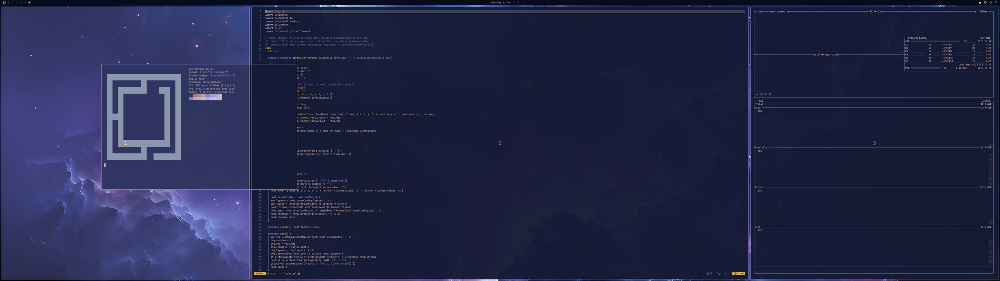
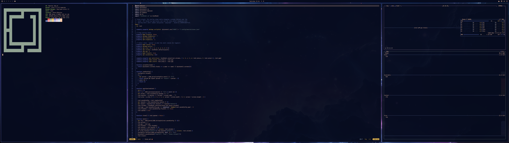
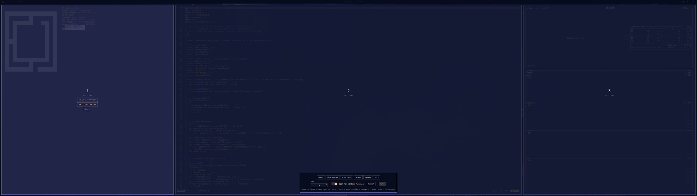

# Omarchy FancyZones

FancyZones-style window snapping and a zone editor for [Omarchy](https://omarchy.org)
(Hyprland). A PowerToys FancyZones alternative for Linux: define zones once, then
drag windows into them. Built for ultrawides, where tiling every window across 32:9
is too wide, but works on any monitor.

- **Super + Shift + drag** a window to show the zones; release over one to snap into it.
- **Super + Shift + Z** opens the zone editor on the focused monitor.
- **Super + drag** still moves windows freely.


*Super + Shift + drag shows the zones; release to snap into the highlighted one.*


*Snapped into the Focus (25 / 50 / 25) layout on a 5120×1440 ultrawide.*

## Editor




- Pick a preset, or drag the lines between zones to resize them.
- Hover a zone to split it side by side, split it top / bottom, or remove it.
- Set the gap between zones and whether new windows open floating (off by default).
- **Enter** or **Save** writes the layout; **Esc** or **Cancel** discards it.

Layouts are saved per monitor (by output name, e.g. `HDMI-A-1`), and the
first one saved also becomes the `default` used by monitors without their own.

## Files

| Path | What |
|------|------|
| `manifest.json` | Shell plugin manifest |
| `Zones.qml` | Drag overlay and zone editor |
| `ZoneModel.js` | Layout math and presets |
| `hypr/zones.lua` | Hyprland side: binds, drag tracking, snapping |
| `~/.config/omarchy/zones.json` | Settings, written by the editor |

## Install

1. Add and enable the plugin (it installs to `~/.config/omarchy/plugins/fancyzones/`):

   ```sh
   omarchy plugin add https://github.com/junderw52/omarchy-fancyzones.git --enable
   ```
2. Load the Hyprland side from `~/.config/hypr/hyprland.lua`:

   ```lua
   dofile(os.getenv("HOME") .. "/.config/omarchy/plugins/fancyzones/hypr/zones.lua")
   ```

3. Check it with `hyprctl configerrors`.

No other dependencies: it uses the Omarchy shell and Hyprland's Lua config.

## Remove

1. Delete the `dofile(...)` line from `~/.config/hypr/hyprland.lua`.
2. Remove the plugin:

   ```sh
   omarchy plugin remove fancyzones
   ```

3. Optionally delete your saved layouts: `rm ~/.config/omarchy/zones.json`.

The plugin is `keepLoaded`, so changes to `Zones.qml` need `omarchy restart shell`.
Set `"debug": true` in `zones.json` to log drags to `~/.local/state/hypr-zones.log`.

## License

MIT. See [LICENSE](LICENSE).
